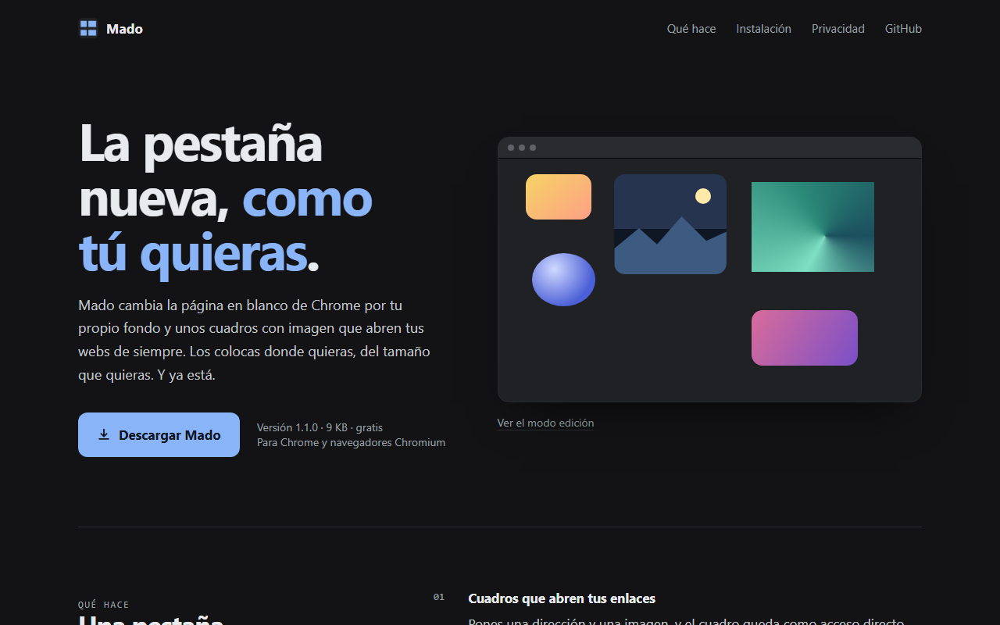

<div align="center">


# Mado

**Una nueva pestaña para Chrome con tu propio fondo y cuadros con imagen que abren tus enlaces.**


[**Descargar**](site/mado.zip) · [Cómo se instala](#instalación) · [Privacidad](#privacidad)



</div>

---

## Qué es

Mado sustituye la página de nueva pestaña por un lienzo tuyo: un color o una imagen de fondo y los cuadros que quieras,
cada uno con su imagen y su enlace. Se colocan donde quieras y se editan en la propia pestaña, sin pantallas de ajustes.

No incluye buscador, noticias ni widgets. Solo lo que pongas tú.

## Funciones

- **Cuadros con enlace:** cuadrado, redondeado o círculo; la imagen se rellena, se muestra completa o se estira.
- **Edición directa:** arrastra para mover, tira de la esquina inferior derecha para cambiar el tamaño y suelta una imagen sobre un cuadro para asignarla.
- **Fondo e icono:** color liso o imagen de fondo, y icono de pestaña personalizado.
- **Imágenes ligeras:** se redimensionan y comprimen a WebP al subirlas.
- **Sin parpadeos:** el color de fondo se pinta antes de que cargue el resto, así la pestaña no «salta».
- **Copia de seguridad:** exporta e importa todos tus cuadros y el fondo en un único `.json`.

## Instalación

Mado no está (todavía) en la Chrome Web Store, así que se carga a mano. Son dos minutos.

1. Descarga [`mado.zip`](site/mado.zip) y descomprímelo. Obtendrás una carpeta `mado`; no la borres después, Chrome la lee desde ahí.
2. Abre `chrome://extensions` (`edge://extensions` en Edge, `brave://extensions` en Brave).
3. Activa el **modo desarrollador** (arriba a la derecha).
4. Pulsa **Cargar descomprimida** y elige la carpeta `mado` (la que contiene `manifest.json`).
5. Abre una pestaña nueva. La primera vez entra directamente en modo edición.

Para volver a editar, pulsa el icono de Mado en la barra de herramientas. `Esc` o **Listo** cierran el modo edición.

> Pensada para Chrome. Debería funcionar igual en otros navegadores basados en Chromium con Manifest V3, pero solo está probada en Chrome.

## Privacidad

- Todo se guarda en `chrome.storage.local`, en tu navegador. No hay servidor, cuentas, analítica ni peticiones de red.
- Permisos: `storage` (recordar tus cuadros y tu fondo) y `unlimitedStorage` (que las imágenes grandes no agoten la cuota).
- No lee las webs que visitas ni tu historial.

## Estructura del repositorio

```
mado/
├── extension/          # El código de la extensión (se carga tal cual en Chrome)
│   ├── manifest.json
│   ├── newtab.html / newtab.css / newtab.js
│   ├── boot.js         # Pinta el fondo al instante, antes de leer el almacenamiento
│   ├── background.js   # Service worker: el icono de la barra abre el modo edición
│   └── icons/
├── site/               # La web de descarga (estática)
│   ├── index.html
│   └── mado.zip        # Generado con scripts/package.py
├── scripts/package.py  # Empaqueta extension/ en site/mado.zip
├── docs/               # Captura y fuente de la imagen para compartir
└── wrangler.jsonc      # Despliegue de site/ en Cloudflare Workers
```

## Desarrollo

No hay build ni dependencias. Carga la carpeta `extension/` como descomprimida (pasos 2–4) y recarga la
extensión desde `chrome://extensions` después de cada cambio.

Para publicar una versión nueva:

```bash
# 1. Sube "version" en extension/manifest.json
# 2. Regenera el zip que descarga la web
python scripts/package.py
```

## Web de descarga

`site/` es una página estática sin recursos externos. Se despliega en Cloudflare Workers como assets estáticos:

```bash
npx wrangler deploy
```

O conecta el repositorio desde el panel de Cloudflare: build command vacío, deploy command `npx wrangler deploy`.

## Licencia

[MIT](LICENSE) © 2026 Moisés García Poveda
